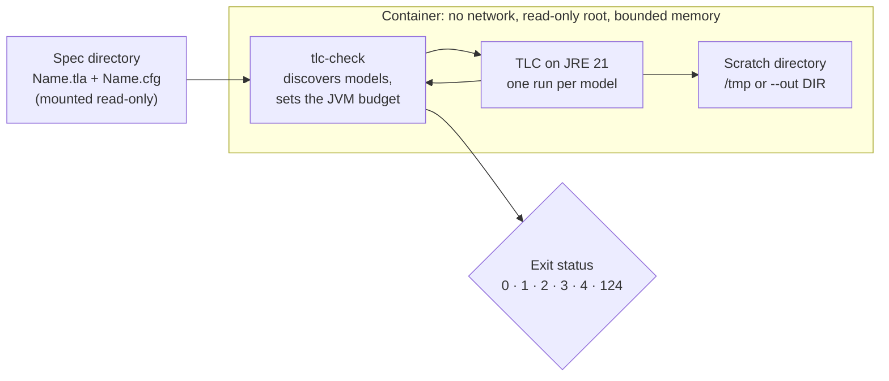

# Contract

This document is the contract of tlaplus-toolchain: what the image contains,
how the `tlc-check` command behaves, and how a project runs it safely. The
image build and `tlc-check` implement this contract. A change to the behavior
described here changes this document first.

> **Status.** Pre-release. The image is not published yet. The first release
> is `v0.1.0`.

## Contents

- [Overview](#overview)
- [The image](#the-image)
- [Versioning](#versioning)
- [The `tlc-check` command](#the-tlc-check-command)
- [The run contract](#the-run-contract)
- [Memory policy](#memory-policy)
- [Security: threat model](#security-threat-model)
- [The usage standard](#the-usage-standard)
- [Non-goals](#non-goals)

## Overview

A project keeps its TLA+ specifications in one directory. It mounts that
directory read-only into the container and runs `tlc-check`. `tlc-check` runs
the TLC model checker once per model and returns one exit status for the whole
directory.



## The image

| Property | Value |
|---|---|
| Name | `ghcr.io/xiam/tlaplus-toolchain` |
| Base | Eclipse Temurin JRE 21, pinned by digest |
| TLC | `tla2tools.jar` v1.7.4, verified at build time against SHA256 `936a262061c914694dfd669a543be24573c45d5aa0ff20a8b96b23d01e050e88` |
| Commands | `tlc-check`, plus `make`, `git` and `python3` |
| Platforms | `linux/amd64`, `linux/arm64` |
| User | not root by default; the image runs as any UID |
| Run-time needs | no network, no writable root filesystem |

- TLC v1.7.4 is the last stable release. The v1.8.0 line is a rolling
  pre-release: its published bytes change over time, so it cannot be pinned by
  checksum. A dated v1.8.0 snapshot track is added only when a consumer needs a
  v1.8.0 feature.
- The image contains no download step at run time.
- The OCI image labels and `tlc-check --version` report the TLC version, the
  jar checksum and the JRE version.
- The pins live in one file, `pins.env`. The update procedure is in
  [PINS.md](PINS.md).

| Image label | Value |
|---|---|
| `io.github.xiam.tlaplus-toolchain.tlc.version` | TLC release, for example `1.7.4` |
| `io.github.xiam.tlaplus-toolchain.tlc.sha256` | SHA256 of `tla2tools.jar` |
| `io.github.xiam.tlaplus-toolchain.jre.version` | Temurin JRE version, for example `21.0.13+9` |
| `org.opencontainers.image.base.name` | Base image repository and tag |
| `org.opencontainers.image.base.digest` | Digest of the base image index |

- The default user is `10001:10001` (`tlc`). `HOME` is `/tmp`, so a run as any
  other UID needs no home directory. `tla2tools.jar` is at
  `/opt/tlaplus/tla2tools.jar`; the environment variable `TLA2TOOLS_JAR`
  holds that path.

## Versioning

- A release of this repository is a Git tag `vX.Y.Z`.
- The release publishes exactly one image tag `X.Y.Z` (the tag without the
  `v`). Release `v0.1.0` publishes `ghcr.io/xiam/tlaplus-toolchain:0.1.0`.
- There is no `latest` tag and no floating tag. Consumers pin a tag, or better,
  a digest.
- A published tag is never moved. A fix ships as a new patch release.
- The release procedure, its checks and its verification are in
  [RELEASE.md](RELEASE.md).

## The `tlc-check` command

### Synopsis

```text
tlc-check [OPTIONS] [DIR]
tlc-check --version
tlc-check --help
```

`DIR` is the spec directory. The default is `specs`, relative to the working
directory.

### Model discovery

- A model is a file `<Name>.cfg` in `DIR`, checked against `<Name>.tla` in the
  same directory. One invocation checks one directory; subdirectories are not
  searched.
- By default, `tlc-check` checks every `<Name>.cfg` except the deep models.
- A deep model is a file `<Name>.deep.cfg`. With `--deep`, `tlc-check` checks
  every `<Name>.deep.cfg` against `<Name>.tla`, and only those.
- A model whose `<Name>.tla` is missing, or a directory that holds no model for
  the selected mode, is a usage error (exit status 2) reported before any model
  starts.

### Options

| Option | Meaning | Default |
|---|---|---|
| `--deep` | Check the deep models (`<Name>.deep.cfg`) instead of the default models. | off |
| `--memory SIZE` | Set the JVM budget `B` explicitly. See [Memory policy](#memory-policy). | derived from the container limit |
| `--workers N` | Number of TLC worker threads. | the CPUs available to the container: the CPU affinity, reduced by a CPU quota such as `--cpus` |
| `--deadline DURATION` | Deadline for each model. | `30m` |
| `--out DIR` | Scratch directory for TLC state files, logs and counterexample traces. | a new directory `/tmp/tlc-check-*` |
| `--version` | Print the `tlc-check`, TLC and JRE versions and exit. | |
| `--help` | Print usage and exit. | |

- `SIZE` is a positive integer with the suffix `k`, `m` or `g` (KiB, MiB,
  GiB), for example `1g` or `1536m`.
- `DURATION` is a positive integer with the suffix `s`, `m` or `h`, for example
  `90m`.
- An invalid option or value is a usage error (exit status 2).
- Projects with a strict resource policy set every resource option
  explicitly, for example `--workers 1 --memory 1g --deadline 60m`.
- `--out DIR` is created when it does not exist. It must not be the spec
  directory or lie inside it, and none of the paths that `tlc-check` creates
  in it (`<Name>.states`, `<Name>.log`, `<Name>.hs_err_pid*`) may be the spec
  directory or contain it (exit status 2, before any model starts).
  `tlc-check` does not follow a symbolic link at a log path.
- `tlc-check` runs the jar named by the environment variable `TLA2TOOLS_JAR`
  (default `/opt/tlaplus/tla2tools.jar`, where the image installs it).

### Output and the scratch directory

- For each model, `tlc-check` prints a header line, streams the TLC output
  live, and prints one result line. After the last model it prints a summary
  with one line per model: `  <Name>.cfg: status <N>: <detail>`.
- The TLC output of each model is kept in `<out>/<Name>.log` (`<Name>.deep.log`
  for a deep model). The log holds the counterexample trace of a violation.
- TLC keeps its state files in `<out>/<Name>.states/` while the model runs.
  `tlc-check` removes that directory when the model ends, so the next model
  has the whole scratch space.
- TLC v1.7.4 writes no trace file (`*_TTrace_*`) next to the spec; that
  feature arrived after v1.7.4. Its only default write next to the spec is the
  states directory, which `tlc-check` moves to the scratch directory with
  `-metadir`. `tlc-check` does not pass the options that write other files
  (`-dump`, `-generateSpecTE`). It runs TLC with the per-model states directory
  as the working directory and as `java.io.tmpdir`, and writes a JVM crash
  log, if any, to `<out>/<Name>.hs_err_pid<N>.log`, so nothing is written into
  the spec directory.

### The state-count guard

A model can declare how many distinct states it expects, in a comment line of
its `.cfg` file:

```text
\* expected-states: 12345
```

- When TLC finds more than `10 × N` distinct states, the model fails (exit
  status 1), even if TLC reports no error. The guard catches a model that has
  grown far beyond its intended size.
- A marker is a line comment whose first word is `expected-states`. A marker
  that does not have the form above, or whose value is not a positive integer,
  is unreadable, and so are two markers with different values. An unreadable
  marker fails the model (exit status 1) before TLC starts. A comment that
  mentions the word later in its text is not a marker.
- A model without a marker has no guard; `tlc-check` still prints its state
  count.

### Exit status

| Status | Meaning |
|---|---|
| 0 | Every model passed. |
| 1 | A model failed: TLC found a violation or an error, the state-count guard tripped, or the guard marker is unreadable. |
| 2 | Usage error, reported before any model starts. |
| 3 | A model ran out of memory. |
| 4 | The scratch directory is full. |
| 124 | A model reached its deadline. |

- `tlc-check` names the model that caused every non-zero status other than 2.
- A JVM that is killed, or ends in any way other than a clean TLC result, never
  counts as a pass.
- `tlc-check` checks every model before it exits; one failing model does not
  stop the others.
- When models end with different non-zero statuses, the summary lists each
  model's status, and `tlc-check` returns the first that applies in this
  order: 124, 4, 3, 1. A deadline comes first because it hides the true result
  of a model; then a full scratch directory and memory exhaustion, which are
  resource problems of the run, not of the spec.
- When `tlc-check` itself receives `SIGINT`, `SIGTERM` or `SIGHUP`, it stops
  the running JVM (as for a deadline), prints the summary, and exits with
  128 + the signal number.

## The run contract

The hardened invocation below is the one supported way to run the image, on a
workstation and in CI. A project changes only the mount path and the limits.

```sh
docker run --rm \
  --network none --read-only --tmpfs /tmp:size=256m,mode=1777 \
  --cap-drop ALL --security-opt no-new-privileges \
  --user "$(id -u):$(id -g)" \
  --memory 2g --memory-swap 2g --cpus 2 --pids-limit 512 \
  -v "$PWD/specs:/specs:ro" \
  ghcr.io/xiam/tlaplus-toolchain:<tag> tlc-check /specs
```

### Mounts

- Mount the directory that holds the `.tla` and `.cfg` files at any path in
  the container (`/specs`, `/test`, or another), and pass that path to
  `tlc-check`.
- The mount is **read-only**. `tlc-check` never writes into the spec
  directory. It writes TLC state files, logs and counterexample traces to the
  scratch directory: `/tmp` by default, or the directory given with `--out`.
- To keep the traces, mount a writable host directory and pass it with
  `--out`.
- Mount only the spec directory. Never mount the repository root, a home
  directory or the Docker socket.

### Recommended container limits

- `--memory` equal to `--memory-swap`, so the container cannot swap.
- `--cpus` and `--pids-limit`, so a spec cannot take every CPU or exhaust the
  process table.
- A size on every `tmpfs` (`--tmpfs /tmp:size=256m,...`).

## Memory policy

A model that is too large fails cleanly with a named model and exit status 3
or 4. It does not crash the host.

Docker counts the data in a `tmpfs` against the memory limit of the
container. The policy therefore covers the JVM **and** the scratch directory.

### Terms

| Term | Meaning |
|---|---|
| `L` | The memory limit of the container (cgroup). |
| `S` | The size of the scratch directory when it is a `tmpfs`; 0 when it is disk-backed (a bind mount or a volume given with `--out`). |
| `B` | The JVM budget: Java heap plus TLC off-heap fingerprint memory. |
| headroom | Fixed memory outside `B`: JVM native memory (metaspace, threads, code cache, the fixed part of the garbage collector), the `tlc-check` process and kernel memory. **128 MiB.** |

### Rules

- `tlc-check` always starts the JVM with an explicit budget `B`. It never lets
  the JVM size itself from the host RAM.
- `tlc-check` splits `B` into **70 % Java heap** (`-Xmx`), **25 % off-heap
  fingerprint memory** (`-XX:MaxDirectMemorySize`, used by TLC's
  `OffHeapDiskFPSet`, which `tlc-check` selects) and **5 % reserve** for the
  garbage-collector structures that grow with the heap. See
  [Measurements](#measurements).
- The smallest budget is 128 MiB. A smaller `B` is a usage error (exit
  status 2).
- Default: `B = L − S − headroom`.
- When the container has no memory limit, `B` is 2 GiB and `tlc-check` prints
  a warning, because nothing then protects the host. A `--memory` below the
  minimum budget is still a usage error.
- `--memory SIZE` sets `B` explicitly. When `B + S + headroom` is greater than
  `L`, `tlc-check` rejects the value with exit status 2 before any model
  starts. It never clamps silently.
- The scratch directory must be bounded. In a memory-limited container,
  `tlc-check` rejects a `tmpfs` scratch directory without a size limit, with
  exit status 2. The hardened invocation gives `/tmp` a size (`size=256m`). A
  project whose models spill many states to disk mounts a disk-backed
  directory and passes `--out`.
- When the scratch directory fills up (states, logs or traces), `tlc-check`
  stops the model, names it and returns exit status 4. It detects a full
  scratch directory from its own failed log write or from TLC's "No space
  left on device" error; a JVM that keeps running 30 seconds after that
  error is stopped.
- `tlc-check` removes `JAVA_TOOL_OPTIONS`, `_JAVA_OPTIONS` and
  `JDK_JAVA_OPTIONS` from the JVM environment, so the environment cannot
  override the budget.
- When a model exhausts the heap, the JVM exits at once
  (`-XX:+ExitOnOutOfMemoryError`). `tlc-check` names the model and returns
  exit status 3.
- Every model has a deadline (`--deadline`; default 30 minutes). A model that
  only grows slower ends with exit status 124. At the deadline, `tlc-check`
  sends `SIGTERM` to the JVM, waits 10 seconds, sends `SIGKILL`, and waits for
  the JVM to end, so no JVM is left behind.
- A kernel OOM kill of the JVM, detected from the cgroup's `oom_kill`
  counter, also ends with exit status 3.

### The JVM invocation

`tlc-check` starts TLC once per model as follows. Nothing else reaches the
JVM's options.

```text
java -Xmx<70 % of B> -XX:MaxDirectMemorySize=<25 % of B>
     -XX:+UseParallelGC -XX:+ExitOnOutOfMemoryError
     -XX:-UsePerfData -XX:+DisableAttachMechanism
     -XX:ErrorFile=<out>/<Name>.hs_err_pid%p.log -Djava.io.tmpdir=<states>
     -Dtlc2.tool.fp.FPSet.impl=tlc2.tool.fp.OffHeapDiskFPSet
     -cp tla2tools.jar tlc2.TLC
     -workers <N> -metadir <states> -config <DIR>/<Name>.cfg <DIR>/<Name>.tla
```

- TLC v1.7.4 keeps its fingerprints on the heap by default
  (`MSBDiskFPSet`). `tlc-check` selects `OffHeapDiskFPSet` so that the
  fingerprints have their own, fixed share of `B`. That set takes the whole
  `MaxDirectMemorySize` at start, whatever `-fpmem` says, so `tlc-check` does
  not pass `-fpmem`.
- When a model needs more fingerprints than the off-heap share holds, TLC
  moves them to disk in the states directory, and the scratch directory then
  needs room for them.

### Measurements

Measured on 2026-11-17 with TLC v1.7.4 on Eclipse Temurin JRE 21 (x86-64),
in containers with `--memory` equal to `--memory-swap`. "Peak" is the
largest value of `anon + kernel` in the container's `memory.stat`, sampled
every 20 ms: the memory that the kernel cannot reclaim (a tmpfs adds its
`shmem` on top). The measured process tree is the whole container,
`tlc-check` included.

**Worst case.** A test-only `java` wrapper added `-Xms` equal to `-Xmx` and
`-XX:+AlwaysPreTouch`, so the whole heap was resident from the start; the
off-heap fingerprint set is resident from the start anyway (TLC zeroes it).
A grid model (81 million states) ran with a disk-backed `--out`, so `S` = 0:

| `L` | CPUs | `B` | heap + off-heap | peak | overhead | margin to `L` | kernel OOM kills |
|---|---|---|---|---|---|---|---|
| 512 MiB | 2 | 384 MiB | 269 + 96 MiB | 437 MiB | 72 MiB | 74 MiB | 0 |
| 2 GiB | 4 | 1920 MiB | 1344 + 480 MiB | 1911 MiB | 87 MiB | 136 MiB | 0 |
| 4 GiB | 8 | 3968 MiB | 2778 + 992 MiB | 3868 MiB | 98 MiB | 227 MiB | 0 |

"Overhead" is the peak minus heap and off-heap: JVM native memory, the
`tlc-check` process and kernel memory. It is 72 to 98 MiB and grows by about
1 % of the heap, inside the 128 MiB headroom plus the 5 % reserve.

**Native memory breakdown.** The JVM's native memory tracking
(`-XX:NativeMemoryTracking=summary`) at the end of a run reported a fixed part
of about 37 MB (class space and metaspace 10 MB, code cache 9 MB, shared
class space 12 MB, symbols 3 MB, thread stacks 2 to 4 MB for 1 to 12 workers)
and garbage-collector structures of 38 MB, 52 MB and 92 MB for heaps of
128 MiB, 512 MiB and 1536 MiB (about 33 MB + 4 % of the heap).

**Heap exhaustion.** A model whose state doubles at each step exhausted the
heap at every size tried (`L` = 512 MiB to 4 GiB, with the whole heap
resident): the JVM ended with `java.lang.OutOfMemoryError`, `tlc-check`
returned 3, and the kernel killed nothing.

**Off-heap fingerprints.** A model with 16 million states and `B` = 400 MiB
took 5 seconds with `OffHeapDiskFPSet` (200 MiB heap, 200 MiB off-heap) and
77 seconds with TLC's default on-heap set (400 MiB heap).

**Scratch.** The same kind of grid model spilled up to 198 MiB of queued
states into a tmpfs scratch directory, which is why `S` is part of the
budget.

**Default deadline.** The baseline models of seven existing projects (31
models) ran under the hardened invocation with `--memory 2g --cpus 2`. 27
passed; the slowest took 212 seconds, and all others took under 80 seconds.
Two models filled the 256 MiB tmpfs scratch and ended with status 4, as
designed; such projects pass a disk-backed `--out`. The default deadline of
30 minutes is more than eight times the slowest model, and it stays below the
60-minute default job timeout of common CI systems, so that `tlc-check`
reports the model that ran out of time instead of the CI system killing the
job without a summary. Deep models and projects with a strict policy set
`--deadline` explicitly.


### Scope of the guarantee

"Exit status 3 or 4, and no kernel OOM kill" holds for specs that use TLC and
its standard modules, in a container that follows the hardened invocation,
with the default budget or a `--memory` that `tlc-check` accepts.

It rests on the [measurements](#measurements): up to 12 workers and
container limits from 512 MiB to 4 GiB. Each worker thread can use up to
1 MiB of stack, so a run with many more workers than that, or a spec that
recurses very deeply, uses more of the headroom than was measured.

A spec that brings its own Java module overrides can allocate memory outside
this accounting. For such a spec the container limit is the only protection,
and a kernel OOM kill of the container is possible.

## Security: threat model

- **A spec directory is code, not data.** TLC loads Java module overrides
  (`.class` and `.jar` files) from the spec directory, and a spec can drive
  long or unbounded computation. Checking a spec from an untrusted source is
  running untrusted code.
- **The container is the boundary.** The hardened invocation gives the spec no
  network, no writable filesystem except the scratch directory, no Linux
  capabilities, no privilege escalation, a non-root user, and bounded memory,
  CPU and processes.
- **Pass no secrets.** Give the container no credential environment variables
  and no token mounts.
- **Not a sandbox for hostile specs.** The image adds no protection beyond
  these container controls. A CI system that checks specs from untrusted
  contributors runs the job on an isolated runner without credentials.
- **Supply chain.** The base image is pinned by digest, the jar by SHA256, and
  the image downloads nothing at run time. Consumers pin the image by digest.

## The usage standard

A project follows one convention and invents nothing:

- **Layout.** Specs live in `specs/`: one `<Name>.tla` with `<Name>.cfg`, and
  an optional `<Name>.deep.cfg`.
- **Local and CI runs** use the [hardened invocation](#the-run-contract).
- **CI.** The job uses the image and runs `tlc-check`. The consumer guide
  gives examples for GitHub Actions and GitLab CI. The examples are
  illustrations, not maintained templates.

## Non-goals

- CI templates, input gating, proof deferral or any other consumer policy.
- Checks of drift between specs and prose, back-references and model coverage.
- Apalache and TLAPS. The project name leaves room for them; there is no work
  on them now.
